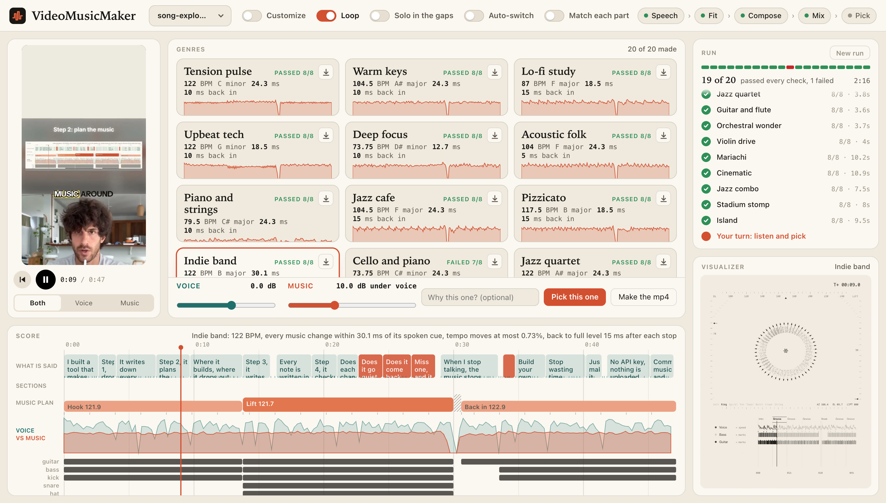
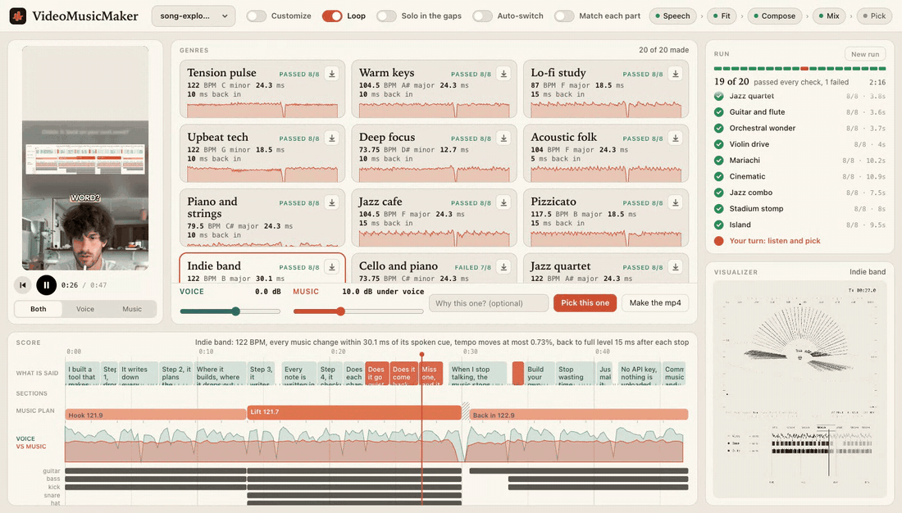
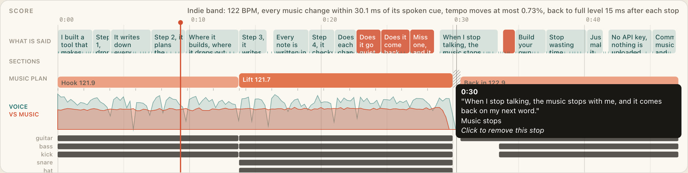
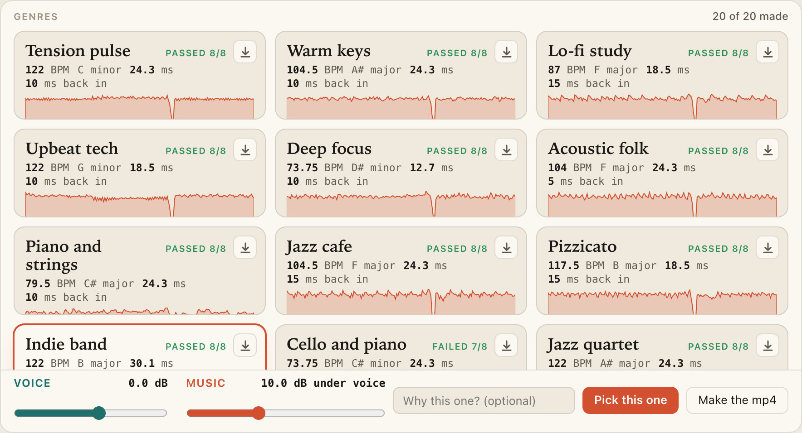
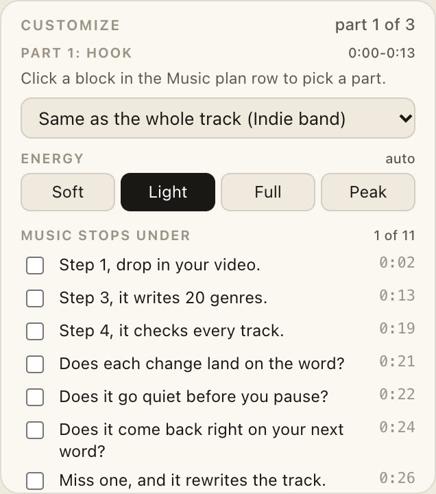

<p align="center">
  
</p>

<h1 align="center">VideoMusicMaker</h1>

<p align="center">
  <b>Music that listens to what you say</b><br>
  Drop in a video of you talking. Get 20 music tracks written for it, each one changing on your words. Runs on your Mac.
</p>

<p align="center">
  <a href="#install">Install</a> ·
  <a href="#the-music-stops-when-you-do">Features</a> ·
  <a href="#every-track-is-checked">The checks</a> ·
  <a href="docs/HOW-IT-WORKS.md">How it works</a> ·
  <a href="https://tools.techguyverlabs.org/t/videomusicmaker">Try it in the browser</a>
</p>

---

Drop a video on the page. About 2 minutes later (2:16 for the 47-second video above) you have:

- **20 tracks in 20 genres**, from Lo-fi study to Mariachi, all new, never stock
- **Changes that land on your words**: the music lifts on a new point, within 60 ms of its first word
- **Stops where you pause**: it drops out under a punchline and comes back on your next word
- **Your video with the music mixed under your voice**, as an mp4

No AI service, no API key, no upload. Speech-to-text runs on your Mac, and the music is written by code and played through a free SoundFont. Every video gets its own take, so two videos never share a track.

## Install

You need a Mac with Apple silicon, [Homebrew](https://brew.sh) and about 2 GB of free disk.

```sh
brew install ffmpeg whisper-cpp rubberband fluid-synth uv node
git clone https://github.com/royherma/videomusicmaker.git
cd videomusicmaker
scripts/install.sh
node server.mjs
```

Open **http://localhost:4812** and drop a video on the page. `scripts/install.sh` sets up Python, downloads the SoundFont (31 MB) and the Whisper model (1.6 GB), then checks everything. `bin/soundtrack doctor` runs that check again any time.

**Use Claude Code?** Install it as a plugin and ask Claude to score your video:

```sh
claude plugin marketplace add royherma/techguyver-tools
claude plugin install videomusicmaker@techguyver-tools
```

## The music stops when you do



It writes down every word with its timing, then plans the music around what you say: a soft open under the hook, a lift on the main point, a full stop under the line that needs to land. Every change is snapped to a beat grid so it lands on its word, not near it.

## Click to change where it stops



The score shows what is said, the music plan and the voice against the music, on one timeline. Click a stop to remove it. Click any pause to add one. Re-cut the same script later and your stops come with it.

## 20 genres, one click apart



Play any genre and the music crossfades in place while the video keeps going. Each card shows its tempo, key and how close its changes landed. **Pick this one** saves your choice, so the genres you pick most move to the top. **Make the mp4** mixes it under your voice.

## Make each part your own

<p align="center"></p>

Turn on **Customize** to give each part of the plan its own genre and energy (Soft, Light, Full, Peak) and tick the lines the music stops under. Other switches on the page:

| Switch | What it does |
| --- | --- |
| Loop | Music runs to the last frame and loops back to the start with no bump |
| Solo in the gaps | A solo plays only in the pauses between your words |
| Match each part | Each part gets a genre whose tempo fits how fast you talk there |

## Every track is checked

Every track is rendered, then measured from the audio file. A track that misses a check is rewritten at a slower, then a faster tempo.

| Check | Passes when |
| --- | --- |
| Changes land on the word | every change within 60 ms of its spoken cue |
| Tempo holds steady | tempo moves less than 3% |
| Clean ending | 0 notes after the final hit |
| Down before the stop | at least 6 dB quieter going into a full stop |
| Silent in the stop | below -25 dB inside the stop |
| Back on the word | full level within 30 ms of the next word |

Loop mode adds two more: tempo carries through the loop point, and the join is within 3 dB. The checks cover timing. Whether a track sounds right is your call on the page.

## Run it from the terminal

```sh
bin/soundtrack speech ~/Movies/take.mp4 --slug take   # words, sentences, pauses
bin/soundtrack make take all                          # all 20 genres, each checked
bin/soundtrack export take lofi                       # mp4 with that track under the voice
```

Runs started here show up on the page too. Each video gets its own folder in `work/<name>/`.

## Built on

| Job | Model or library |
| --- | --- |
| Words and timings | [Whisper](https://github.com/openai/whisper) large-v3-turbo via [whisper.cpp](https://github.com/ggml-org/whisper.cpp) |
| Instruments | [GeneralUser GS](https://github.com/mrbumpy409/GeneralUser-GS) SoundFont played by [FluidSynth](https://www.fluidsynth.org) |
| Analysis and synthesis | [librosa](https://librosa.org), numpy, scipy, numba |
| Time-stretch, video | [Rubber Band](https://breakfastquay.com/rubberband/), [FFmpeg](https://ffmpeg.org) |

Add a genre with one JSON file, trim a raw take before scoring it, and the full pipeline: [docs/HOW-IT-WORKS.md](docs/HOW-IT-WORKS.md). Third-party licenses: [THIRD_PARTY.md](THIRD_PARTY.md).

## License

MIT. Music you make with VideoMusicMaker is yours. Made by [TechGuyver Labs](https://techguyverlabs.org).
