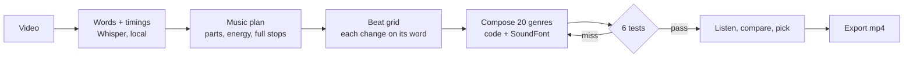

# VideoMusicMaker

Background music written to fit what is said in a video. Give it a talking-head video. It writes down the words
with their timings, plans where the music should change, snaps a beat grid so every change lands on the first word
of its sentence, and composes 20 genres over that grid. Each track is measured against 6 tests and rewritten if it
misses one. You listen, compare and pick in a local web page, then export the mp4.

No AI service and no API key. Speech-to-text runs locally (Whisper via whisper.cpp). The music itself is code:
chords, melodies, drums and instruments written by the engine, played through a free SoundFont and its own synths.
Every video gets its own take: each genre's key, tune and broken-chord pattern are seeded by the video and the take
number, so two videos never share a track and **New run** (`make --fresh`) writes a new take. Rerunning without
`--fresh` repeats the take exactly, so edits change only what you edited.



## Install (macOS)

```sh
brew install ffmpeg whisper-cpp rubberband fluid-synth node
scripts/install.sh        # Python env, packages, SoundFont (31 MB), Whisper model (1.6 GB); ends with a check
bin/soundtrack doctor     # rerun any time: every program, package and file, with the fix for a missing one
```

Linux works the same with `apt install ffmpeg rubberband-cli fluidsynth libfluidsynth3 nodejs` and whisper.cpp built
from source. Python 3.11 or newer. Settings: `WHISPER_MODEL` (path to a ggml model), `DEMUCS` (only for learning from
a reference song), `PORT` (page, default 4812), `VMM_WATERMARK` (text in the visualizer's corner).

## Use

```sh
node server.mjs                                    # http://soundtrack.localhost:4812 - drop a video on the page, everything runs
bin/soundtrack speech <video.mp4> --slug demo      # or by hand: words, sentences, pauses
bin/soundtrack make demo all                       # all 20 genres, each checked against the 6 tests
bin/soundtrack export demo <genre> [--under 10]    # mp4 with that track mixed under the voice (-14 LUFS)
bin/soundtrack make demo --song <file.mp3>         # re-cut a real song on its own bars to the same cues
bin/soundtrack themes                              # list the genres
```

On the page: the video and its score on the left and bottom, the 20 genre cards in the middle (play any, the music
crossfades in place), the run on the right. **Customize** gives each part of the plan its own genre, energy and stops.
**Pick this one** records your choice; genres are ranked by picks.

## The 6 tests

Every track is rendered, then measured from the audio file. Limits live in `GATES` in `engine/mix.py`.

| Test | Pass when |
| --- | --- |
| Changes land on the word | every music change within 60 ms of its spoken cue |
| Tempo holds steady | tempo moves less than 3% |
| Nothing plays after the last chord | 0 notes after the final hit |
| Already down before the stop | at least 6 dB quieter going into a full stop |
| Silent until it comes back | below -25 dB inside the stop |
| Back in on the word, no fade | full level within 30 ms of the next word |
| Tempo carries through the loop | Loop mode only: under 3% tempo change from the last part to the first |
| Loops with no bump | Loop mode only: the 2 bars before the loop point within 3 dB of the 2 after |

**Loop mode** (page switch, or `work/<slug>/mode.json` `{"loop": true}`): music runs to the video's last frame (video
stream length, not file length), ends on the chord that leads into the first, and whatever rings past the end is
added onto the start. The last part drops back to the opening's energy so the join is level. The mp4 is cut to the video length.

A miss rewrites the genre at a slower, then a faster tempo; if it still fails, the best try is kept and marked failed.
The tests check timing, not taste: whether a track sounds good is your call on the page.

## Trim a raw take first (optional)

Phone takes with fumbles: cut by the waveform, not the transcript.

```sh
D=work/<slug>/trim
.venv/bin/python -I scripts/trim.py phrases <raw.mp4> $D          # phrases split at real pauses, text on each
# write $D/keep.json: {"keep": [phrase numbers]}
.venv/bin/python -I scripts/trim.py cut <raw.mp4> $D <raw>-cut.mp4
.venv/bin/python -I scripts/trim.py check <raw.mp4> $D            # each kept piece alone through Whisper + wave.png
```

`phrases` needs WhisperX (`pip install whisperx`, or set `WHISPERX`).

## Add a genre

A genre is one JSON file in `engine/themes/`: key, chords per variant, and per layer the instrument, rhythm, notes,
the energy level it comes in at, gain and effect sends. New genre = new file, no code.

- `notes: "melody"` writes a solo line (`range` [low, high] MIDI, `style` lyrical|flowing|swing|drive) in 8-bar
  phrases; `copy` + `shift` doubles another layer; `notes: "walk"` is a walking bass; `duckVoice` (dB) drops a layer
  while the voice speaks.
- Instruments: `sf:<name>` plays from the SoundFont (names in `GM` in `engine/synth.py`), `phys:<name>` from the
  engine's own modelled instruments (`TABLE` in `engine/phys/inst.py`), `kit:` / `brush:` / `jazz:` / `orch:` for drums.
- `bin/soundtrack learn <video.mp4>` measures the music in a video you like (tempo, key, how far under the voice,
  where it stops) so you can match it. Needs Demucs.

What two reference videos taught the defaults: music sits 5-9 LU under the voice, keeps 80%+ of its energy under
400 Hz so it stays out of the voice's range, stops dead under a turn line ("But hold on.") and comes back one level
higher on the next sentence.

## Files

| Path | What |
| --- | --- |
| `engine/` | Python: speech, plan, compose, synth, mix, tests |
| `page/`, `server.mjs` | The local web page (no npm packages) |
| `work/<slug>/` | Everything made for one video (not in git) |
| `library/` | Your picks and every render's measured numbers |

License: MIT (`LICENSE`). Third-party parts and their licenses: `THIRD_PARTY.md`.
